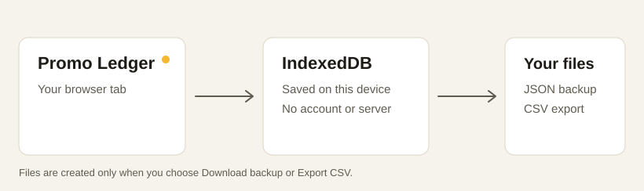

# Promo Ledger

Track paid creator promotions in one private, local ledger. See what you have earned this month, what brands still owe you, and which payments are overdue.



The [design system artifact](https://claude.ai/artifact/4Ngc3LyTsVkWn4gHGJyvCo) guided the colors, type, spacing, status language, responsive table, and detail panel. This repository turns that design into a working app.

## Run it locally

You need **Node.js 20 or newer**. No package install, account, API key, or database server is needed.

```bash
git clone https://github.com/cneuralnetwork/promo-ledger.git
cd promo-ledger
npm start
```

Open **[http://127.0.0.1:4173](http://127.0.0.1:4173)**. Leave the terminal running while you use the app. Press `Ctrl+C` to stop the local static server.

If port 4173 is taken, choose another one:

```bash
PORT=5000 npm start
```

The server binds to `127.0.0.1`, so it is available only on your own computer. It serves files and has no API or account system.

## Use the ledger

1. Choose **Add promo** and enter the brand, deliverable, and fee.
2. Leave a deal as **Draft**, or choose **Invoiced** and add its payment due date.
3. When the money arrives, open the promo and choose **Mark as paid**. You can edit the paid date afterward.
4. Use **All promos** to search, sort, and filter. **Brands** groups deals by brand. **Invoices** shows invoiced and paid deals.
5. Use **Export CSV** for a spreadsheet. On All promos and Invoices, it exports the current search and filter results. Go to **Settings → Download backup** for a restorable JSON copy of the whole ledger.

An unpaid invoice becomes **Overdue** automatically after its due date. **Owed to you** includes all unpaid invoices, including the overdue ones. **Earned this month** counts promos with a paid date in the current month. All money amounts show two decimal places.

Settings also has **Add sample records** if you want to explore the interface before entering real deals. The sample records are fictional, are never added automatically, and are not duplicated if you use the button again.

## Where your data goes

Promo records are saved in your browser's **IndexedDB** database. Appearance and currency preferences are saved in browser local storage. There is no cloud sync or tracking. This also means that another browser, browser profile, or device starts with a separate ledger.

**Make a backup before clearing site data or moving to another device.** To restore one, open **Settings → Import backup** and choose the downloaded JSON file. Import adds records and updates matching IDs; it does not delete other records. If your current ledger already has promos, the backup must use the same currency.

The app caches its HTML, JavaScript, CSS, and self-hosted fonts after the first visit. Once loaded, it can reopen without the local server. Keep a JSON backup anyway: the offline cache contains the app files, not a second copy of your records.

## Currency

The default is USD. Before adding records, go to **Settings** to choose USD, EUR, GBP, INR, CAD, or AUD. A ledger uses one currency. The choice is locked after the first record so amounts cannot be silently relabeled as another currency.

## Optional database integration

This release uses IndexedDB because it runs locally with no backend. The persistence functions are isolated in [`src/db.js`](src/db.js). To sync to Render Postgres or another remote SQL database, add a small authenticated service and implement those functions against its API. Do not put SQL credentials in browser JavaScript. The JSON backup is a straightforward migration source.

## Project map

| File | Purpose |
| --- | --- |
| `index.html` | App shell, record form, and detail panel |
| `styles.css` | Design tokens and responsive layout |
| `src/app.js` | Screens, interactions, form handling, exports |
| `src/ledger.js` | Status, dates, money, CSV, backup validation |
| `src/db.js` | IndexedDB storage |
| `service-worker.js` | Offline app file cache |
| `server.mjs` | Local static file server only |

The typefaces are self-hosted under `fonts/`. Their licenses are in `fonts/licenses/`.

## Check the code

```bash
npm test
```

The tests cover overdue dates, money totals, amount parsing, CSV quoting, and backup validation. There are no runtime dependencies and no build step.

## Troubleshooting

- **The page does not open:** Confirm `npm start` is still running, then use the exact address printed in the terminal.
- **Your records are missing:** Check that you are using the same browser and profile as before. If you cleared site data, import your JSON backup.
- **The browser blocks storage:** Open the app in a regular browser window with site storage enabled. Private windows may erase data when closed.
- **You see an older version after updating:** Reload while the local server is running. The service worker refreshes cached app files from the server when online.

## License

App code is MIT licensed. Bundled fonts have their own licenses in [`fonts/licenses/`](fonts/licenses/).
